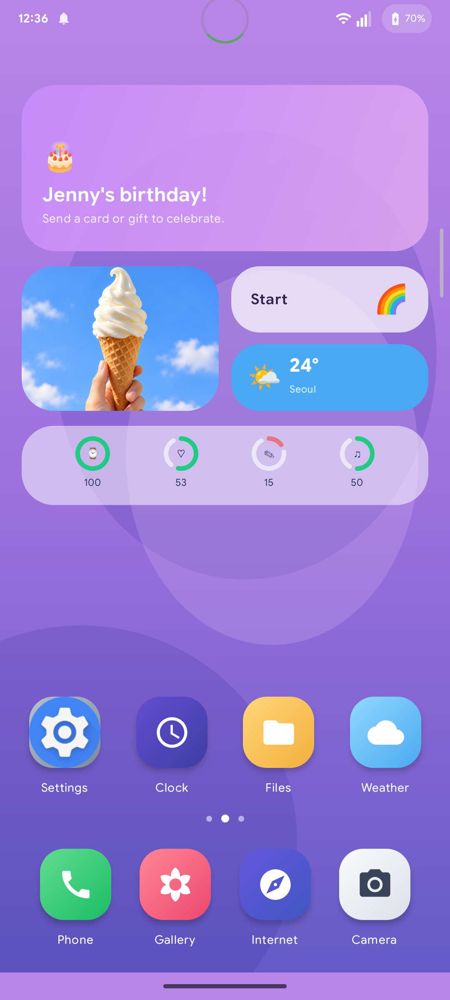
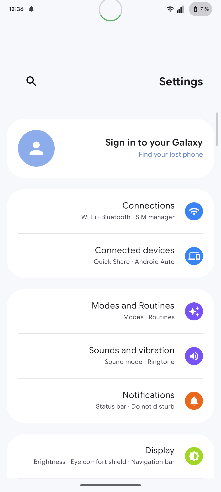
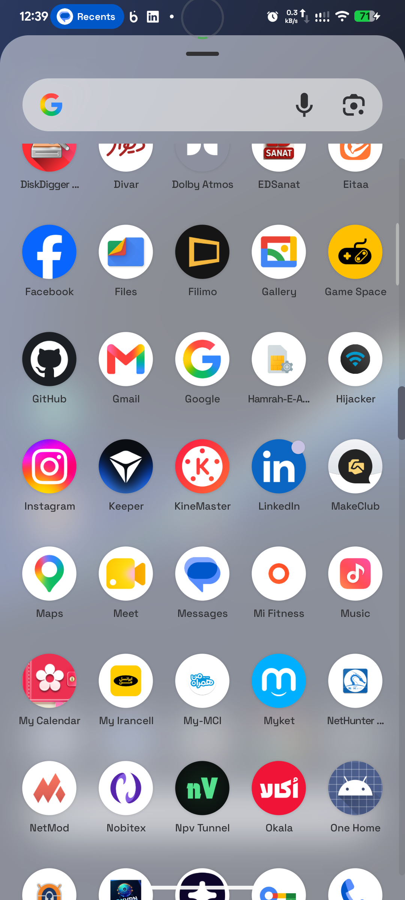

# One Home

### A polished Android launcher UI study

One Home is a native Android prototype built with **Kotlin and Jetpack Compose**. It explores a colourful home screen, a compact system style shell, Persian and English layouts, and familiar phone settings flows. The project is designed as a portfolio piece and a runnable source example.

> **Independent concept.** One Home is not affiliated with or endorsed by Samsung. Brand names and installed app icons shown at runtime belong to their respective owners.

<p align="center">
  
  
  
</p>

## Highlights

- **Launcher:** three swipeable home pages, an app drawer, a persistent dock, and runtime icons from installed apps where available.
- **System style shell:** a custom status bar and an in-app quick settings shade. Battery, charging, Wi-Fi, and cellular indicators are read from Android; quick setting controls are local demo state.
- **Phone flows:** a keypad, an animated demo call, `*#06#` identifier sheet, and an editable demo device profile.
- **Settings:** grouped settings, About phone, and an optional Android Home role request through the system chooser.
- **Localization:** English and Persian UI with RTL layout and Persian digits in the status clock and battery indicator.
- **Media shortcuts:** Camera and Gallery tiles open installed device apps when available.

## What is simulated?

The weather widget, birthday card, identifier values, phone number, calls, most launcher tiles, and quick setting switches are **demo content**. The dialer does not place a call. The app does not change Android Wi-Fi, mobile data, or other device settings. Battery and network indicators are read-only live device data. Camera and Gallery hand off to installed apps.

The app requests only `ACCESS_NETWORK_STATE`; it does not request contacts, call log, SMS, location, device identifier, or camera permissions. It has no internet permission.

## Build and run

Requirements: **JDK 17**, **Android SDK API 36**, and an Android device or emulator running **API 26+**.

```bash
./gradlew test assembleDebug
adb install -r app/build/outputs/apk/debug/app-debug.apk
```

For device UI tests:

```bash
./gradlew connectedAndroidTest
```

The debug APK is generated at `app/build/outputs/apk/debug/app-debug.apk`. Build outputs and local signing material are intentionally excluded from version control.

## Explore the demo

1. Open **Phone** and enter `*#06#` to display the demo identifier sheet.
2. Enter `*#00#` to open the hidden profile editor. Change the display language or demo values, then save.
3. Open **Settings → About phone** to see the same persisted profile.
4. Tap the in-app status bar to open the demo quick settings panel.

The editable profile and demo quick settings are stored with Preferences DataStore. The optional Home role is requested only when the user selects it in Settings; Android presents its own chooser.

## Project map

| Area | Source |
| --- | --- |
| Launcher and app tiles | `app/src/main/java/com/example/demolauncher/ui/launcher/` |
| Phone and identifier flows | `app/src/main/java/com/example/demolauncher/ui/dialer/` |
| Settings and About phone | `app/src/main/java/com/example/demolauncher/ui/settings/` |
| Custom status bar and quick settings | `app/src/main/java/com/example/demolauncher/ui/systemui/` |
| Live battery and network readings | `app/src/main/java/com/example/demolauncher/data/system/DeviceStatusRepository.kt` |
| Navigation and DataStore profile | `app/src/main/java/com/example/demolauncher/ui/navigation/`, `app/src/main/java/com/example/demolauncher/data/` |

## Notes

- Screenshots were captured from a running debug build on an Android phone. The birthday and weather cards in those images are demo content; battery and network indicators reflect that phone at capture time.
- System bars and gestures are controlled by Android. The in-app quick settings panel is a visual prototype, not a replacement for Android's system panel.
- Generated Graphify output, local signing keys, Gradle caches, and APKs are excluded from the repository. Run `graphify app/src/main/java` locally if you want to regenerate the code graph.
- A public repository does not grant reuse rights by itself. No open-source license is included at this stage.
